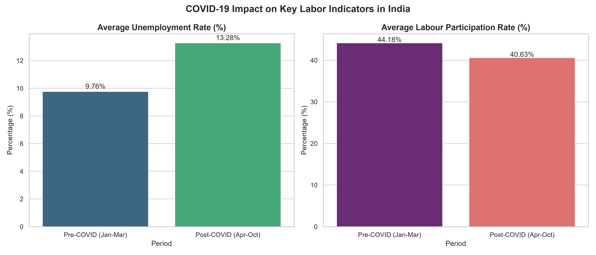
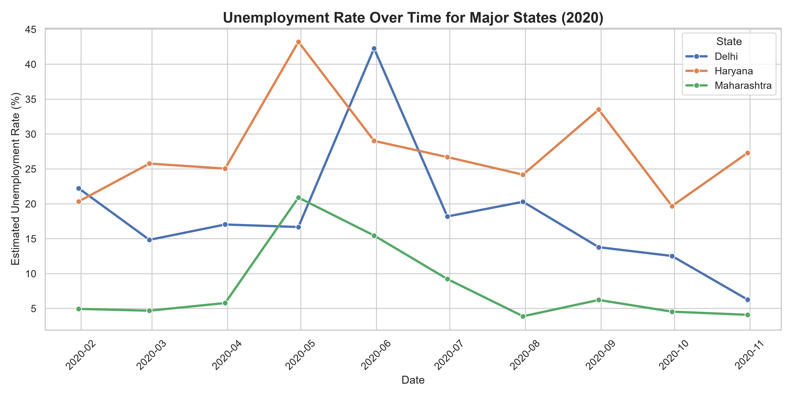
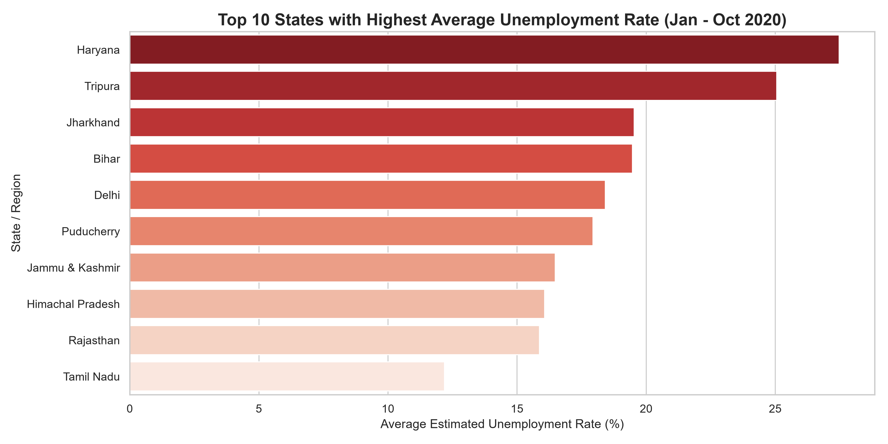
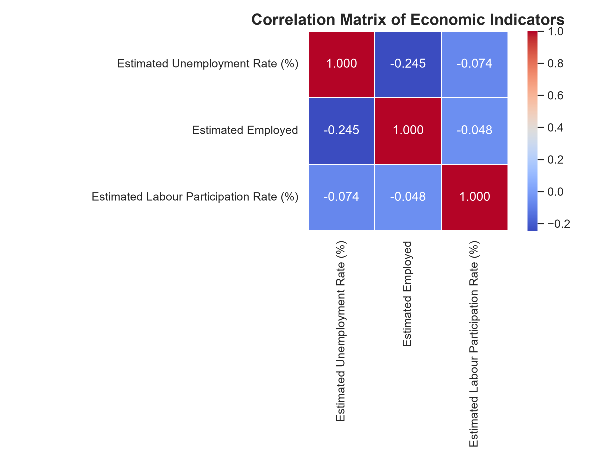
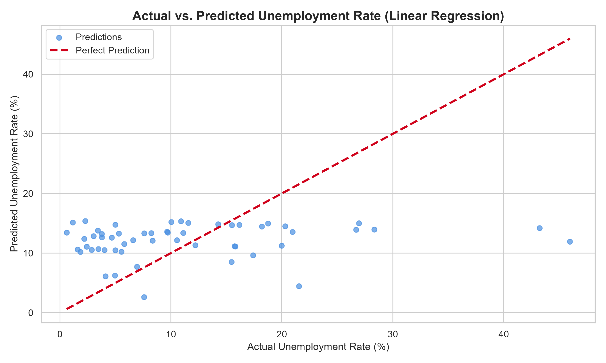

# Unemployment Analysis in India (COVID-19 Impact & Basic ML)

A comprehensive exploratory data analysis (EDA) and basic machine learning modeling project analyzing the regional and temporal trends of unemployment rates in India, with a specific focus on the severe economic impacts of the COVID-19 pandemic.

## Tech Stack
- **Python 3**
- **Data Manipulation**: `pandas`, `numpy`
- **Visualization**: `matplotlib`, `seaborn`
- **Machine Learning**: `scikit-learn`
- **Environment**: `Jupyter Notebook`

---

## Dataset Description
The analysis utilizes two related datasets:
1. **`Unemployment in India.csv`**: Contains area-wise (Rural/Urban) weekly/monthly data from May 2019 to June 2020.
2. **`Unemployment_Rate_upto_11_2020.csv`**: Contains state-wise monthly data from January 2020 to October 2020, along with regional zone details and coordinates (latitude/longitude).

---

## Key Visualizations & Findings

### 1. Pre-COVID vs. Post-COVID Comparison
A comparison of national averages between Pre-COVID (Jan-Mar 2020) and Post-COVID (Apr-Oct 2020) periods reveals the severe impact of the pandemic:
- **National Average Unemployment Rate** rose from **10.32%** to **13.06%** (a **26.5% relative increase**).
- **Labour Participation Rate (LPR)** fell from **42.49%** to **40.42%**, signaling worker discouragement.



### 2. Time-Series Trends for Major States
Analysis of unemployment rates over time for three key states (**Delhi**, **Maharashtra**, and **Haryana**) shows:
- **Delhi** experienced a dramatic spike in May 2020 (peaking over **42%**).
- **Maharashtra** jumped from ~5% to over **20%** in April 2020.
- **Haryana** maintained a high base throughout, peaking at **41%** in April 2020.



### 3. Top 10 States with Highest Average Unemployment Rate
Over the 2020 period, states like **Haryana** and **Tripura** averaged unemployment rates exceeding **25%**.



### 4. Correlation Heatmap
The correlation matrix shows a distinct negative correlation between `Estimated Unemployment Rate (%)` and `Estimated Employed` count (**-0.245**), showing job losses.



---

## Machine Learning Model (Linear Regression)
A basic **Linear Regression** model was trained to predict the `Estimated Unemployment Rate (%)` using `Estimated Employed` and `Estimated Labour Participation Rate (%)` as features:
- **Model Output**:
  - `Estimated Employed` Coefficient: **$-1.97 \times 10^{-7}$** (As employment increases, unemployment rate decreases)
  - `Estimated Labour Participation Rate` Coefficient: **$+0.165$** (Higher LPR increases the unemployment rate if jobs are scarce)
  - Test MSE: **96.8856** (RMSE: **9.84** percentage points)
  - Test $R^2$ Score: **0.0754** (expectedly low since macro-economic outcomes are non-linear and dependent on policy variables, lock-down intensity, and global conditions).



---

## Repository Structure
```text
├── .gitignore
├── README.md
├── requirements.txt
├── Unemployment in India.csv
├── Unemployment_Rate_upto_11_2020.csv
├── unemployment_analysis.ipynb
├── covid_impact_comparison.png
├── indicators_heatmap.png
├── ml_actual_vs_predicted.png
├── time_series_states.png
└── top_10_states_bar.png
```

---

## Quick Start & Setup

1. **Clone the Repository**:
   ```bash
   git clone <your-repo-link>
   cd iris
   ```

2. **Set up a Virtual Environment (Optional but Recommended)**:
   ```bash
   python -m venv venv
   # On Windows:
   venv\Scripts\activate
   # On macOS/Linux:
   source venv/bin/activate
   ```

3. **Install Dependencies**:
   ```bash
   pip install -r requirements.txt
   ```

4. **Launch Jupyter Notebook**:
   ```bash
   jupyter notebook
   ```
   Open `unemployment_analysis.ipynb` and run all cells to view code execution and analysis plots.
